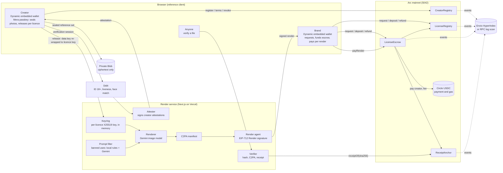

<p align="center"></p>

# Likeness

**License your face to AI. Your terms, paid per image.**

**Live app:** [likenesss.vercel.app](https://likenesss.vercel.app) (Arc mainnet) ·
**Code:** [github.com/rohitshukla11/likeness-arc](https://github.com/rohitshukla11/likeness-arc) ·
**Contracts:** [below](#contracts-on-arc-mainnet), verified on Sourcify

Likeness is a likeness-licensing protocol with a reference app on top, live on Arc mainnet. Real,
verified adults license their face to brands and AI tools, get paid in USDC for every image made with it,
and can pull it back at any time.

## The problem

Generative AI can put anyone's face into an ad in seconds. The people in those images are rarely asked,
almost never paid, and have no way to stop it. Brands that *want* to use a real person's likeness have
no clean way to get consent, pay per use and prove it later: today the options are a one-off model
release signed for a photoshoot, or nothing at all.


## The solution

Likeness turns consent into a licence that software can check. A creator proves they are a real, live
adult, seals encrypted reference photos of their face and publishes terms. A brand requests a licence,
the creator approves it, and every image rendered under it pays the creator and records an on-chain
receipt in the same transaction. Each file carries a C2PA content credential, anyone can check it, and
one click revokes the licence so the next render is refused.


## How it works

**Verify → License → Earn → Prove or revoke**

1. **Verify.** The creator signs in with email, and a Dynamic embedded wallet is created for them (with a
   one-time 0.05 USDC gas top-up). Didit checks an ID document for 18+, a liveness selfie and a
   selfie-to-ID face match. Three guided photos are matched to that selfie, encrypted in the browser under
   a key from the creator's passkey (Mera), and only the ciphertext is uploaded. The platform attests the
   creator on chain.
2. **License.** The creator sets uses, regions, a price per render and limits. A brand with a brand
   profile requests a licence; the creator approves it with an EIP-712 signature (or it is issued at once
   inside their auto-approve terms). The brand deposits USDC into escrow.
3. **Earn.** The creator releases their photos to that licence only. Each render checks the licence, the
   cap, the escrow and the banned-use filter, decrypts the photos in memory, renders with Gemini, signs a
   C2PA manifest and calls `LicenseEscrow.payRender`: the creator is paid, the 10% fee is taken and the
   receipt is anchored, in one transaction.
4. **Prove or revoke.** Anyone can drop a file on `/verify` and see Licensed, Expired, Revoked or
   Unknown, with the creator, the licensee and the receipt. The creator can revoke one licence or all of
   them: the next render is refused, earlier files verify as "licensed when made, since revoked", and the
   brand refunds the unused escrow.


## Why Arc

Pay-per-render means **one transaction per generated image**: the creator is paid and the receipt is
recorded together, before the file reaches the brand.

- **USDC is both the payment and the gas.** On Arc, USDC is the native gas token, and its ERC-20
  interface (`0x3600…0000`, 6 decimals) is what the escrow holds and pays out. Creators and brands only
  ever touch dollars: no second token to buy, price or explain. New wallets get a one-time 0.05 USDC gas
  top-up.
- **Deterministic finality.** Arc finalises a transaction on inclusion
  ([docs](https://docs.arc.io/arc/concepts/deterministic-finality)), so a render's payment and receipt
  are final before the file is delivered, and a revocation binds the very next render.
- **Measured on this deployment** (send to receipt over Arc's public RPC, 2026-10-14): the eight
  deployment transactions confirmed in **1,215–1,795 ms** each, and cost **0.164571 USDC**
  in gas together; wiring calls cost under 0.001 USDC each.

## Traction

- We've spoken with creators and brands directly. Creators described the hustle of shoots (travel, long
  days, reshoots) for a one-time fee; brands described delayed content, slipping shoot dates and the
  effort of recreating an ad for every new variation.

## Contracts on Arc mainnet

Deployed 2026-10-14 (UTC) on Arc mainnet (chain 5042) from
`0x68343Aa0598b7FCAA102769D172e59cdDfae10f2`, which is also the owner and treasury (10% fee), starting at
block 25,968,293. All four contracts are **exact matches on Sourcify** (chain 5042).
Machine-readable: [`deployments/arc-mainnet.json`](deployments/arc-mainnet.json).

Creator terms default to 0.10 USDC per render for 10 renders over 7 days, deposits are capped at 2 USDC per licence (in
the app), and the site renders at most 20 Gemini images a day.

| Contract | Address | Deploy tx |
|---|---|---|
| CreatorRegistry | [`0x87934d5E1A61be3Bb06FE54AC7e21E7704731d1C`](https://explorer.arc.io/address/0x87934d5E1A61be3Bb06FE54AC7e21E7704731d1C) | [`0x4203de7a…`](https://explorer.arc.io/tx/0x4203de7a70718bd757b7ba71489c116c83e49167545f7984b7a999369629ed81) |
| LicenseRegistry | [`0xE33Dc788C060cb77F79A2AFF96Ca685f6C018721`](https://explorer.arc.io/address/0xE33Dc788C060cb77F79A2AFF96Ca685f6C018721) | [`0xc3fd6e90…`](https://explorer.arc.io/tx/0xc3fd6e90487b0a9694deda4f5f88c357f76f34c11b6eb4310409eb29ad8429fb) |
| ReceiptAnchor | [`0x38703a57c5f8eB2F8d1576A3d2B4B35A10D66FA6`](https://explorer.arc.io/address/0x38703a57c5f8eB2F8d1576A3d2B4B35A10D66FA6) | [`0x151b54dc…`](https://explorer.arc.io/tx/0x151b54dc1302e8e54999e728ca23ab40445e2bdf7def614d8a6c4d912f9709db) |
| LicenseEscrow | [`0x8a747D78811066F58A0dDe04E82165A02fA37725`](https://explorer.arc.io/address/0x8a747D78811066F58A0dDe04E82165A02fA37725) | [`0x96221eea…`](https://explorer.arc.io/tx/0x96221eea18e7f4d87165211dbcbc2573308b728753e0c03d01ad8198338721a2) |
| USDC (Circle, ERC-20 interface) | [`0x3600000000000000000000000000000000000000`](https://explorer.arc.io/address/0x3600000000000000000000000000000000000000) | [Arc docs](https://docs.arc.io/arc/references/contract-addresses) |

Roles: attester `0x7e001C6c704fa2C90ab47C2d2df921902B64527F`; render agent
`0x8660d805D9Fb741Cef9B57d5e93Db3bDD8171F75`; gas top-up wallet
`0x0a498bab501Be6826f30b904Df16fecbc93dAEF1`; owner and treasury `0x6834…10f2`.

| Contract | What it holds | Who writes |
|---|---|---|
| [`CreatorRegistry`](contracts/src/CreatorRegistry.sol) | Platform-signed attestation (Didit: ID 18+, liveness, face match), terms, payout, revocation epoch | Creator (terms, payout, revoke-all); the attester signs but cannot submit; the owner rotates the attester and can suspend for abuse |
| [`LicenseRegistry`](contracts/src/LicenseRegistry.sol) | Non-transferable, expiring licences (ERC-721 locked per [ERC-5192](https://eips.ethereum.org/EIPS/eip-5192)) | Brand requests with the creator's EIP-712 approval, or inside auto-approve terms; creator revokes; only the escrow counts renders |
| [`LicenseEscrow`](contracts/src/LicenseEscrow.sol) | USDC per licence; pays the creator per render, refunds the rest | Brand deposits; a render needs the brand's wallet **and** a render agent's signature |
| [`ReceiptAnchor`](contracts/src/ReceiptAnchor.sol) | One receipt per rendered file, looked up by its sha256 | Only the escrow, only inside a paid render |

## Architecture



## Business model and go-to-market

- **Revenue:** a 10% fee on every paid render, taken by the escrow contract in the same transaction that
  pays the creator. Then a verification and licensing API for AI tools: check a face's licence, pay per
  render and anchor receipts through the same contracts.
- **Customers:** AI ad and avatar tools that need real, consented faces, and the brands that use them.
- **Go-to-market:** start with AI UGC ad tools and the creators who already make UGC ads.

## Roadmap

- **Next: video ad renders:** full short ads from a licensed face, under the same licence, receipt and
  verifier.
- **Then: voice licensing:** creators license their voice on the same terms, with the same consent,
  payment and revocation.
- **One person, one creator:** today one person could register more than one wallet, because nothing
  compares identities across wallets. The fix is a keyed duplicate-document check: an HMAC, under a
  server secret, of the ID document's country, type and number from Didit's decision, refusing a second
  attestation with the same value without storing the number itself.
- **Casting calls:** a brand posts a brief, and matching creators choose whether to reveal themselves.
- **Before larger amounts on mainnet:**
  - an independent audit of the four contracts, especially the escrow and the payout logic;
  - Didit at the full verification level (active liveness), under a production agreement and a
    data-processing agreement;
  - a C2PA signing certificate from a trusted certificate authority, replacing the test certificate;
  - Dynamic's production environment instead of the sandbox;
  - a legal entity, and licence terms reviewed by counsel for likeness licensing.

## Privacy and safety

- **Only ciphertext is stored.** Reference photos are encrypted in the creator's browser (AES-256-GCM)
  under a key derived from their passkey through Mera. The server stores ciphertext and hashes, and the
  chain holds only a hash of the encrypted manifest and of the Didit session ID. Passkey-derived keys
  never leave the browser. The server decrypts photos in memory for one render and zeroes them
  afterwards ([what the server sees](docs/mera.md#what-the-server-sees-in-plaintext)).
- **What Didit sees, and for how long.** Didit sees the ID document and the liveness selfie, and at the
  `full` level matches the three reference photos. Likeness calls those photo matches with
  `save_api_request=false`, and deletes the session with `privacy_erasure` as soon as the attestation is
  signed. Whether Didit also keeps a face-search embedding for duplicate detection depends on the
  workflow's settings in the Didit console; the code doesn't set it. Didit's own retention is a console
  setting (unlimited by default), and it uses data for model training unless the organisation opts out;
  the operator must set both. Likeness keeps the outcome and the session ID, never the date of birth,
  document images or selfie.
- **What Google sees, and for how long.** The Gemini image model receives the decrypted reference photos
  for each render. On a billed key Google doesn't use them to improve its products, but logs them for 55
  days for abuse monitoring ([Gemini API terms](https://ai.google.dev/gemini-api/terms)). A free-tier key
  must never be used with creators' photos.
- **Banned uses are enforced in the contract.** Political, adult, anything involving minors,
  impersonation and deception are a constant bitmask in [`Categories.sol`](contracts/src/Categories.sol):
  no terms, signed deal or role can license them. The render service applies the same list to every
  prompt before generation.
- **Adults only.** `CreatorRegistry` registers only attested adults (18+ computed from the ID's date of
  birth), and the app is presented as adults-only.
- **Every output is marked:** a C2PA manifest declaring it AI-generated, Google's SynthID watermark, and
  an on-chain receipt keyed by its exact bytes.

## Running it locally

Needs Node 22 or later, Foundry 1.8.3, and [Arc Foundry](https://docs.arc.io/arc/tutorials/install-arc-foundry)
(`arc-forge`, `arc-anvil`), which models Arc's native USDC for fork tests.

```sh
cd web
cp .env.example .env.local     # local defaults; add credentials as they arrive
pnpm install
pnpm c2pa:testcert             # once: a TEST C2PA signing chain in ../.secrets/c2pa
pnpm dev                       # http://localhost:3000
```

Each credential turns on one feature, and `/status` shows what is configured: Dynamic
(`NEXT_PUBLIC_DYNAMIC_ENV_ID`), Didit (`DIDIT_API_KEY`, `VERIFICATION_LEVEL`, workflow IDs; the `free`
level also needs `pnpm face:models`), Gemini (`GEMINI_API_KEY`, a billed key) and the USDC gas top-up
(`DRIP_KEY_FILE`).

### Tests

```sh
cd contracts && forge test --no-match-path "test/fork/*"                    # unit, fuzz, invariant
cd contracts && ARC_RPC_URL=https://rpc.mainnet.arc.io arc-forge test --match-path "test/fork/*" --network arc
cd web && pnpm test            # crypto, render pipeline, profiles, and the licence lifecycle on an arc-anvil fork
cd indexer && pnpm test        # Envio handlers on the in-memory test indexer
```

- **Contracts:** every revert path; fuzz tests that banned uses are never stored or licensed and that
  each render conserves funds; an invariant suite for USDC conservation, render caps and refunds; and an
  Arc mainnet fork suite with Circle's real USDC.
- **Web:** the cross-device passkey test and envelope encryption; the banned-use filter, the C2PA round
  trip and tamper detection; the deposit cap and the daily render limit; and, on an arc-anvil fork of Arc
  mainnet with the deployed contracts and no mocks, the whole licence lifecycle, re-verification at a
  higher level, and public profiles, samples and brand onboarding.

### Deploying

Contracts: `pnpm deploy:arc --preflight` rehearses every transaction on an arc-anvil fork and prices it
at the live gas price; `pnpm deploy:arc --broadcast` sends them one at a time. The web app runs on Vercel:
see [docs/deploy-vercel.md](docs/deploy-vercel.md).

## Contributor notes

- **No real brand or product names** in demos, fixtures, tests, docs, screenshots or placeholder text. Use
  fictional ones, such as "Brew & Co.", and `.example` domains.

## Licence

[MIT](LICENSE)
